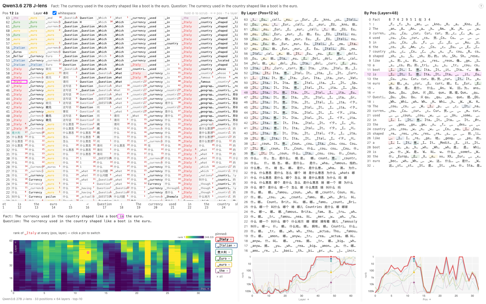
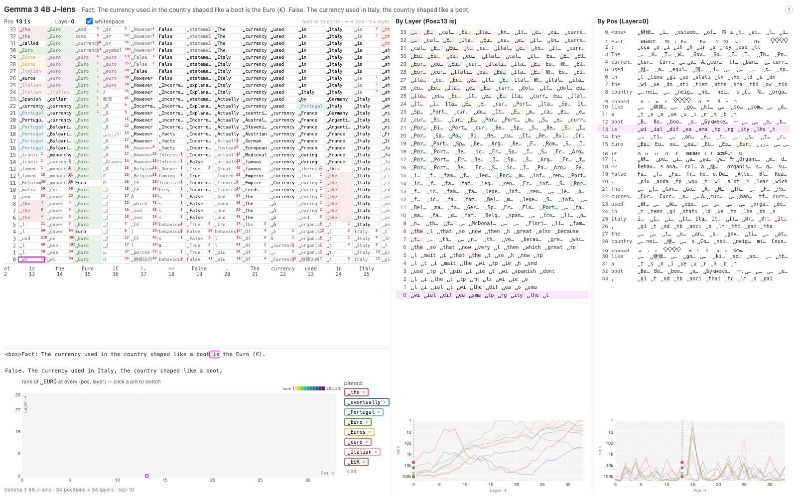

# Jacobian lens on Gemma 3 and Qwen (MacBook / MPS, or a RunPod GPU)

Anthropic's [Jacobian lens](https://transformer-circuits.pub/2026/workspace/index.html)
(`jlens`, reference code at github.com/anthropics/jacobian-lens) applied to Gemma 3 4B and
Qwen3.5/3.6.

The lens needs gradients through the residual stream, so it runs on the HuggingFace
weights in PyTorch: MPS on the Mac, CUDA on a GPU pod. Ollama is not used: llama.cpp is
inference-only and exposes no gradients or activations. Stop it while running the lens
(`pkill ollama`), because a loaded model holds GBs of the Mac's shared memory.

Every script takes `--model`:

| `--model` | HF weights | Runs on | Notes |
|---|---|---|---|
| `gemma-3-4b` (default) | `unsloth/gemma-3-4b-it` (ungated mirror of `google/gemma-3-4b-it`) | MacBook | 34 layers, 8.6 GB bf16 |
| `qwen3.5-4b` | `Qwen/Qwen3.5-4B` | MacBook | 32 layers, 9.3 GB bf16 |
| `qwen3.6-27b` | `Qwen/Qwen3.6-27B` | 80 GB+ GPU: see [RUNPOD.md](RUNPOD.md) | 55.6 GB bf16 |

Pre-fitted lenses come from `neuronpedia/jacobian-lens` (1000 wikitext prompts each).

## Result: the boot-shaped country

Prompt: *"Fact: The currency used in the country shaped like a boot is"*. Gemma 3 4B
answers " the Euro (€)". The answer requires a hidden step (boot → Italy → euro), and the
J-lens shows that step in the middle layers, at the final " is" token, before the model
writes anything:

```
L17 logit-lens: [' iconic', ' called', ' ', ' legendary', ' now']
L17 J-lens:     [' Portugal', ' Portuguese', ' France', ' Belgium', ' Italy']
L25 logit-lens: [' called', ' Italian', ' the', ' euros', ' currency']
L25 J-lens:     [' Italian', ' euros', ' Euros', ' euro', ' Italy']
L32 J-lens:     [' the', ' Euro', ' called', ' Euros', ' Italian']
model output:   [' the', ' Euro', ' called', ' Euros', ' Italian']
```

The plain logit lens is noise at L17. The J-lens shows candidate European countries by
L17 and Italy/euro by L25.

### The same prompt on Qwen

| Model | Answer | Italy visible at " is"? |
|---|---|---|
| Gemma 3 4B (34 layers) | " the Euro (€)" | Yes: candidate countries by L17, Italy/euro by L25 |
| Qwen3.5-4B (32 layers) | " the Euro." | **No**: formatting noise at L16, then straight to currencies (L24: `' currency', ' dollars', ' euros'`) |
| Qwen3.6-27B (64 layers) | " the euro." | **Yes**: Italy is the top-1 lens token at every layer from L37 to L53 |

**Qwen3.6-27B** (run on a RunPod GPU, see [RUNPOD.md](RUNPOD.md)) shows the hidden step
clearly, and in two languages:

```
L16 J-lens:     [' amongst', ' really', ' truly', ' basically', ' though']
L32 J-lens:     [' ___', ' ______', ' ____', '___', '____']
L48 J-lens:     [' Italy', ' Italian', 'Italy', '意大利', '____']
L62 J-lens:     [' Euro', ' euro', ' the', ' Euros', ' called']
model output:   [' the', ' Euro', ' called', ' euro', ' EUR']
```

意大利 is Chinese for Italy, and it is the top token at L36, just before English " Italy"
takes over at L37. Above L53 the reading moves to " Italian" and then to " euro" / " Euro".

**[Open the Qwen3.6-27B slice view](https://andrewwilsonnew.github.io/jacobian-lens/results/qwen3.6-27b-boot/?ctx=12&layer=48&pinned=14898-14382-108936-18870-17146-279&ht=14898&ws=1)**
(" is" at L48 selected; " Italy", " Italian", 意大利, " Euro", " euro" and " the" pinned).
The file is [`results/qwen3.6-27b-boot/index.html`](results/qwen3.6-27b-boot/index.html).



Within Qwen, the larger model makes the intermediate country visible to the lens and the
4B model doesn't. With Qwen3.5-4B, either the "boot → Italy" step happens without the
country becoming verbalizable at that position, or the answer comes from a memorised
"boot-shaped country → euro" association. One prompt can't tell these apart.

**[Open the interactive slice view](https://andrewwilsonnew.github.io/jacobian-lens/results/boot-currency/?ctx=13&layer=0&pinned=506-10734-23613-16152-100608-14135-12896-35594-74906&ht=74906&ws=1)**
(prompt plus 20 answer tokens, " is" selected, with " the", " eventually", " Portugal",
" Euro", " Euros", " euro", " Italian", " EUR" and " EURO" pinned). The file is
[`results/boot-currency/index.html`](results/boot-currency/index.html).



Reading the page: the left grid is position × layer (top-1 lens token per cell). **By
Layer** fixes the selected position and lists every layer's top-10. **By Pos** fixes the
selected layer and lists every position's top-10. Each has a rank chart for the pinned
tokens. Click a token to pin it; use the arrow keys to move through positions and layers.

## Other experiments (scripts in this repo)

On Gemma 3 4B unless noted.

- **Multi-step arithmetic** (`digits.py`): on "(23 + 17)*2 + 17 =" the model shows its
  working (40, 80, 97) even when told "don't show working". No number appears at the
  final "=". Each intermediate result forms in a narrow band at L21–L25, first as a
  number word (" eighty", " ninety") and then as the digit. " Forty" shows at L21 one
  layer before " eighty" at L22 (the doubling step).
- **"Don't think about a pink elephant"** (`lens.py --pin`, `pins.py`): during the
  arithmetic answer, "pink" and "elephant" rank no higher than they do on the same sum
  without the elephant sentence, apart from a faint lift for animal words (control:
  " giraffe"). An apparent "pink" trace turned out to be present in the control prompt
  too.
- **"Don't show working" across models:** Gemma 3 4B ignores the instruction and works
  it through to the correct 97. Qwen3.5-4B obeys and answers " 40", which is wrong (it's
  only the bracketed part). Qwen3.6-27B opens a `<think>` block and plans its answer
  ("Key constraint: 'don't show working' - means I should only…"); it had not answered
  within the 60 tokens we generated.

## Usage

```bash
uv sync
uv run python lens.py          # boot-shaped-country prompt
uv run python lens.py "The capital of the state containing Dallas is" --page
uv run python lens.py --example ascii-face --page   # paper examples: see jlens.examples.EXAMPLES
uv run python lens.py --model qwen3.5-4b --page     # same prompt on Qwen
open slices/*/*/index.html     # interactive layer x position view (slices/<model>/<prompt>/)
uv run python digits.py "(23 + 17)*2 + 17 ="        # per-layer rank of each result digit
uv run python lens.py --page --generate 80 --pin pink --pin giraffe "<prompt>"  # track words
uv run python pins.py --pin pink --pin giraffe "<prompt A>" "<prompt B>"        # compare pages

uv run python fit.py --n-prompts 100                # fit your own lens (very slow, see below)
uv run python lens.py --lens lenses/gemma-3-4b_n100.pt
```

For Qwen3.6-27B, or for fitting a lens in minutes rather than hours, see
[RUNPOD.md](RUNPOD.md).

## Usage notes

**Why not Gemma 3 1B.** We tried the 1B model and dropped it. On the boot-shaped-country
prompt, the J-lens shows 1B settling on Spain/Portugal and it never reaches Italy, whereas 4B
reads out Portugal → Italy → euro across layers L17–L25 and answers "the Euro". That pattern
held with both the Neuronpedia lens and a locally fitted one, so it reflects the model and
not the lens. 1B is too weak for the multi-hop examples the lens is interesting on.

**Fitting is slow on a 17 GB MacBook.** Measured on 1B (M5, bf16, MPS): about 90 s per prompt
at `--dim-batch 8`, which works out to ~2.5 h for 100 prompts. 4B has more layers and a
wider residual stream, so expect several times longer per prompt (not measured).
Use the pre-fitted lens unless you need one fitted on a different corpus, or fit on a
GPU pod ([RUNPOD.md](RUNPOD.md)). `fit.py` checkpoints after every prompt and resumes, so
it can run overnight in chunks.

**Keep `--dim-batch` small.** `jlens` replicates the prompt `dim_batch` times and retains
the whole backward graph, so memory scales linearly with it, but total compute does not.
On 1B, `dim_batch=32` reached a 13.6 GB footprint and spent its time in swap (no prompt
finished in 18 min). `dim_batch=8` stayed at 5.7 GB. `fit.py` defaults to 4 for 4B, which
also has to hold ~8.6 GB of weights. Watch `sysctl vm.swapusage` while it runs.

**Qwen on the Mac is slower than Gemma.** Qwen3.5/3.6 use linear-attention
(Gated DeltaNet) layers, and on MPS transformers falls back to reference PyTorch kernels
for them (it prints a `flash-linear-attention` warning). The results are correct, just
slower. On a CUDA pod, `runpod/bootstrap.sh` installs the fast kernels.

A 3-prompt local fit on 1B already matched the n=1000 lens's top tokens at the
mid/late layers. Lens quality plateaus quickly, as the paper notes (§9.3).

## Licence

Apache-2.0 (see [LICENSE](LICENSE)), the same as Anthropic's `jlens`, which this builds
on. The slice page in `results/` is rendered by `jlens` (Apache-2.0) and inlines d3 (ISC).
No model weights or lens files are included. Gemma is subject to Google's Gemma terms;
Qwen3.5/3.6 weights are released by Alibaba under Apache-2.0.
